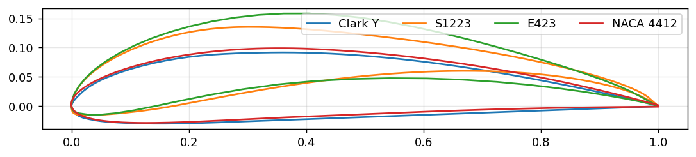
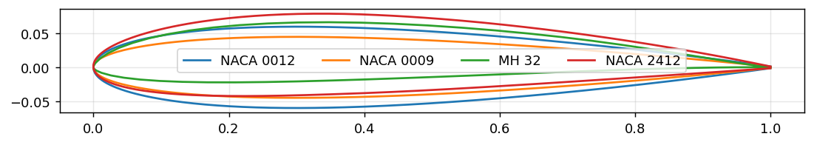

# Problem 1: Airfoil Selection and Aerodynamic Analysis

## 1. Missions and assumptions

We need more wing span for heavier object and stable flight while smaller one can work for more agile one

| | **Aircraft A (payload)** | **Aircraft B (manoeuvrability)** |
|---|---|---|
| Mass | 2.5 kg (0.8 kg payload) | 1.2 kg |
| Wing area / span | 0.50 m² / 1.8 m | 0.33 m² / 1.2 m |
| Aspect ratio, chord | 6.5, 0.28 m | 4.4, 0.275 m |
| Wing loading | 49 N/m² | 36 N/m² |
| Stall speed (3D CLmax 1.6 / 1.0) | ≈ 7.1 m/s | ≈ 7.6 m/s |
| Cruise (1.4 Vs) and Reynolds number | ≈ 9.9 m/s, Re ≈ 190k | ≈ 10.7 m/s, Re ≈ 200k |

Assumptions: sea-level air (ρ = 1.225 kg/m³, ν = 1.46×10⁻⁵ m²/s). The 3D CLmax is derated from the 2D value for finite-wing and tip effects. **All airfoils are compared at Re = 200,000**, which is typical for models of this size.

## 2. Shortlists

**A (payload and stable):** Clark Y, NACA 4412, S1223, Eppler E423.
**B (manoeuvrable):** NACA 0012, NACA 0009, MH 32, NACA 2412.

## 3. Comparison at Re = 200,000

Method: NeuralFoil (xlarge model, a surrogate trained on XFOIL data) via AeroSandbox, sweep α = −6° to 18°, Ncrit default. Script: `polar.py`. Figures: `polars_A.png`, `polars_B.png`.

### Aircraft A

| Airfoil | Thickness / camber | CLmax (α stall) | (CL/CD)max at CL | CL^1.5/CD max | CD at CL = 0.7 | Cm at α=0° | Stall character |
|---|---|---|---|---|---|---|---|
| Clark Y | 11.7% / 3.4% | 1.37 (11.5°) | 74 at 0.97 | 76 | 0.0108 | −0.095 | Moderate |
| NACA 4412 | 12.0% / 4.0% | 1.40 (15.0°) | 79 at 1.20 | 87 | 0.0110 | −0.107 | Gradual, high stall angle |
| S1223 | 12.1% / 8.7% | 2.26 (12.0°) | 72 at 1.72 | 97 | 0.0357 | −0.281 | Sharper lift loss |
| **E423** | 12.5% / 10.0% | **2.02 (11.5°)** | 78 at 1.61 | **103** | 0.0427 | −0.244 | Mild |

### Aircraft B

| Airfoil | Thickness / camber | CLmax (α stall) | (CL/CD)max | CL at α=0° | CD at CL = 0.4 | Cm at α=0° | Stall character |
|---|---|---|---|---|---|---|---|
| **NACA 0012** | 12% / 0% | 1.11 (12°) | 47 | 0 | 0.0110 | 0 | Moderately abrupt, symmetric |
| NACA 0009 | 9% / 0% | 0.88 (9°) | 43 | 0 | 0.0096 | 0 | Abrupt |
| MH 32 | 8.7% / 2.4% | 1.19 (10.5°) | 73 | 0.32 | 0.0090 | −0.072 | Moderate |
| NACA 2412 | 12% / 2% | 1.31 (13.5°) | 67 | 0.29 | 0.0100 | −0.061 | Gradual |

## 4. Selection and justification

### Aircraft A: **Eppler E423**
- Highest CL^1.5/CD (103) of the group: for a given weight it gives the lowest power to stay aloft. CLmax ≈ 2.0 lets the wing carry 49 N/m² at about 7 m/s, so takeoff and landing stay slow even with payload.
- 12.5% thickness gives a deep spar for the bending loads of a heavy wing.
- Trade-offs I accept: Cm ≈ −0.24 means a large nose-down moment, so the tail must carry a download and the trim drag is higher. The thin, undercambered trailing edge is delicate to build.
- Practical fallback: **Clark Y**. It has a flat bottom (easy to build and to measure from), low Cm, and is the common choice for trainers, but it needs a larger wing for the same payload.

### Aircraft B: **NACA 0012**
- Symmetric, so it flies the same upright and inverted, which rolls, loops and inverted flight need. Cm = 0 gives almost no trim change between attitudes.
- Lift is linear in α, so the response to elevator and aileron inputs is predictable. 12% thickness gives structural depth and a gentler stall than the 9% section (CLmax 1.11 vs 0.88).
- Trade-off: lower (CL/CD)max (47) than cambered sections, so glide performance and low-speed efficiency are worse. It needs more power and speed for the same weight. This is acceptable for a short-duration aerobatic aircraft with plenty of thrust.
- MH 32 has lower drag but its camber makes inverted flight inefficient, and it has a thin section, so it is less suitable.

## 5. How airfoil geometry affects performance

| Parameter | Effect |
|---|---|
| Camber | Shifts the lift curve up (non-zero CL at 0°), raises CLmax (E423 2.0 vs NACA 0012 1.1), but makes Cm more negative (E423 −0.24) |
| Thickness | Thicker sections raise CLmax and permit a deeper spar, but raise drag at higher speed. Very thin sections stall abruptly at low Re (NACA 0009) |
| Leading-edge radius | Larger radius gives a more forgiving stall |
| Reynolds number | At Re ~2×10⁵, laminar separation bubbles raise CD for cambered sections at low CL. This is why E423 has high CD at CL = 0.7 (0.043) but is efficient at its design CL ≈ 1.6 |
| Pitching moment | Sets the trim burden and tail size |

## 6. Can one airfoil serve both?

Partly. A moderate section such as **NACA 2412 or Clark Y** gives acceptable L/D, CLmax ≈ 1.3–1.4 and mild Cm. It can fly a payload mission at a reduced weight and do gentle aerobatics, but:
- Against E423 it needs about 45% more wing area for the same stall speed (CLmax 1.37 vs 2.02).
- Against NACA 0012 it flies poorly inverted: it has a positive CL at 0°, so inverted flight needs a large negative α and produces high drag.

Trade-offs: payload and endurance want high camber, high CLmax and low wing loading. Manoeuvrability wants symmetry, a stiff and light structure, low inertia, and high thrust. One airfoil can be a compromise but not optimum for either.

## 7. Airfoil versus whole-aircraft factors

| Factor | Airfoil property? | Why it matters |
|---|---|---|
| Wing loading W/S | **No** (aircraft) | Sets stall speed. B stalls at nearly the same speed as A despite a much lower-lift airfoil |
| Aspect ratio | No | Controls induced drag. A (AR 6.5) glides far better than B (AR 4.4) |
| Control surface size and tail volume | No | Determines roll, pitch rates, stability |
| Structure and mass | No | Sets inertia and ability to carry load |
| Thrust-to-weight | No | Dominant for vertical manoeuvres |
| CG position | No | Sets static margin, independent of the section |
| CLmax, Cm, stall type | **Yes** | Section property, modified by finite-wing effects |

## 8. Bonus: simulation set-up
- Tool: NeuralFoil through AeroSandbox (surrogate trained on XFOIL), Re = 200,000, Mach 0, α = −6° to 18° in 0.5° steps, same settings for all eight airfoils.
- Plots: `polars_A.png`, `polars_B.png` show CL–α, CL–CD, CL/CD–α and Cm–α.
- Limits: surrogate predictions near stall and for thick laminar bubbles are less reliable than XFOIL, and XFOIL itself has uncertain post-stall behaviour. 2D results exclude finite-wing and propeller-slipstream effects. **Before submitting, re-run at least E423 and NACA 0012 in XFLR5 or XFOIL, and note any difference.**

## References
1. Selig, M.S., Donovan, J.F., Fraser, D.B., *Airfoils at Low Speeds* (SoarTech 8), 1989.
2. UIUC Low-Speed Airfoil Data, m-selig.ae.illinois.edu.
3. Drela, M., XFOIL.
4. Sharpe, P., Drela, M., et al., *NeuralFoil* (AeroSandbox project), 2023–2024.
5. Abbott, I.H., von Doenhoff, A.E., *Theory of Wing Sections*, Dover, 1959.
6. Anderson, J.D., *Fundamentals of Aerodynamics*, McGraw-Hill.
