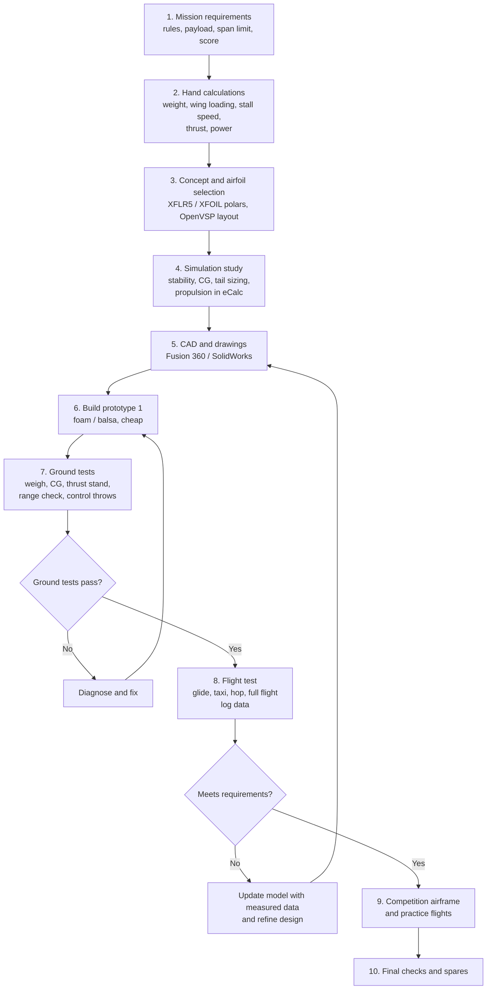

# Problem 3: Simulation vs Practical Development, Technical Proposal

**Role:** lead designer. **Constraints:** national aeromodelling competition, short time, small budget, limited tools.

## 1. Recommendation

**Use a hybrid, build-early approach: light simulation to narrow the design, then a cheap physical prototype in week 1, with each prototype test feeding back into the model.** Simulation is used for questions that are cheap to answer on a computer. The aircraft is used for everything the computer cannot model well. The decision rule: *simulate what is expensive to build, and build what is hard to simulate.*

## 2. Advantages and limitations

| | Simulation-led | Prototype-led |
|---|---|---|
| **Advantages** | Many variants cost nothing but time. Visualises polars, stability, loads. Safe, with no crashes | Reveals real behaviour: build quality, vibration, radio, handling. Builds pilot skill. Finds failures nobody modelled |
| **Limitations** | Result quality depends on inputs and assumptions. Low-Re separation, propeller slipstream and structure flex are hard to model. Learning curve for tools. "Garbage in, garbage out" | Each iteration costs materials and days. Crashes damage parts. Harder to explore the design space. Testing depends on weather and pilot availability |

## 3. Comparison

| Criterion | Simulation-led | Prototype-led | Hybrid (recommended) |
|---|---|---|---|
| Cost | Low (free tools: XFLR5, OpenVSP) | Medium; each airframe ₹2–5k | Low–medium |
| Time to first result | Days (tool learning) | Days (build and fly) | 1 week |
| Accuracy | Good for trends, poor for absolute values at low Re | Highest (real aircraft) | High after validation |
| Iteration speed | Very fast per variant | Slow per variant | Fast on paper, slow on hardware |
| Failure detection | Only modelled failures | Finds unexpected failures | Both |
| Final performance | Risk of over-optimising to the model | Risk of local optimum from few iterations | Best expected |

## 4. Workflow

## 5. What to simulate and what to verify physically

**Simulate (at least three):**
1. **Airfoil polars** (CL, CD, Cm, stall) at the real Reynolds number: XFLR5 / XFOIL.
2. **Static stability and CG range** (neutral point, static margin, tail volume): XFLR5 / OpenVSP.
3. **Propulsion match** (current, thrust, endurance for prop and battery combinations): eCalc or similar.
4. Optional: structural load on spar (hand calculation or ANSYS/Fusion simulation).

**Verify physically (at least three):**
1. **Mass and CG** on a scale and balance, because mass growth is the commonest cause of failure.
2. **Static thrust and current** on a thrust stand with a wattmeter: models over-predict.
3. **Control response and radio range**: surface direction, throws, failsafe, range check.
4. **Structural strength**: wing loading test (support at the root, load the tips), crash survival.
5. **Real glide performance** and stall behaviour, which are hard to model at low Re.

## 6. Validating simulations with measurements

| Predicted | Measured by | Pass criterion |
|---|---|---|
| Mass, CG | Scale, CG balance | Within 3% mass, CG within 2% MAC |
| Static thrust and current | Thrust stand, wattmeter | Thrust within ±15% |
| Stall speed | Flight log, GPS/airspeed or timed pass | Within ±10% |
| Glide ratio | Glide from known height over measured distance | Within ±15% |
| Take-off distance | Measured runway marks | Within ±20% |

If a result is outside the criterion, **correct the model input** (use measured mass and thrust, increase CD0), do not just trust the model.

## 7. Case: simulated plane flies, prototype cannot take off

### Plausible causes
| Group | Causes |
|---|---|
| Mass | Heavier than modelled (glue, wiring, battery, paint), CG too far forward needing large elevator down-force |
| Propulsion | Less thrust than predicted: wrong prop, low battery voltage under load, weak or sagging battery, wrong rotation direction or prop on backwards, ESC limit or timing, prop blocked by fuselage |
| Aerodynamics | Real CD higher than modelled (rough surface, gaps, low-Re bubbles), wing incidence wrong, warped wing, low CLmax, ground effect and no rotation input |
| Controls | Elevator reversed or too little throw, flaps not set, CG too far aft or forward |
| Ground | Soft or rough runway, small wheels, high rolling friction, tail drag |
| Radio | Throttle endpoints not calibrated, so the motor never reaches full power |

### Systematic diagnostic plan (cheapest checks first)
1. **Weigh** the aircraft and compare to model mass. Recompute stall speed and required thrust.
2. **Check CG** against the design position. Fix before anything else.
3. **Check controls**: direction, throws, and full throttle range after ESC calibration.
4. **Static thrust test** with wattmeter: record thrust, current, voltage under load. Compare to prediction. If low, change prop or battery.
5. **Check geometry**: wing and tail incidence, wing twist, symmetry.
6. **Hand-glide test** into the wind on a calm day: if it glides straight, aerodynamics and CG are acceptable, so the issue is power or ground run. If it dives or stalls, adjust CG or incidence.
7. **Taxi tests**, then a **powered hop** from a hand launch.
8. **Update the model** with the measured mass, thrust and CD0 and see if it now predicts the failure.

Change **one variable at a time** and log the result.

## 8. Tools
XFLR5 / XFOIL (airfoil and wing analysis, free); OpenVSP (parametric geometry, vortex-lattice, free); Fusion 360 or SolidWorks (CAD, drawings, laser/CNC cut files); ANSYS (CFD/structures, heavy, not needed for a small-team competition model); eCalc (propulsion). Running software is not mandatory, but XFLR5 and eCalc give the best return on time.

## 9. Bonus: four-week schedule with contingency

| Week | Work | Gate / contingency |
|---|---|---|
| **1** | Requirements, hand calculations, airfoil and layout simulation. **Build quick foam prototype 1** and weigh it | Gate: prototype exists and CG is set. Contingency: 1 day |
| **2** | Ground tests (thrust, CG, radio). Maiden flight tests. Log data. Update model, start CAD of version 2 | Gate: takes off and flies. Contingency: 1–2 days (weather, repairs) |
| **3** | Build prototype 2 / competition airframe with fixes. Test and trim. Order spares | Gate: stable, repeatable flights. Contingency: 2 days |
| **4** | Practice flights, mission rehearsal, spares and field kit, final checks | **Reserve 3–4 days for failure, crash repair and weather.** Freeze design 3 days before the event |

Rule: about 20% of the schedule is contingency, and no design change is allowed in the final 3 days.

## References
1. Raymer, D., *Aircraft Design: A Conceptual Approach*, AIAA.
2. Drela, M., *Flight Vehicle Aerodynamics*, MIT Press, 2014.
3. XFLR5 and OpenVSP documentation.
4. Selig, M.S. et al., *Airfoils at Low Speeds*, 1989.
